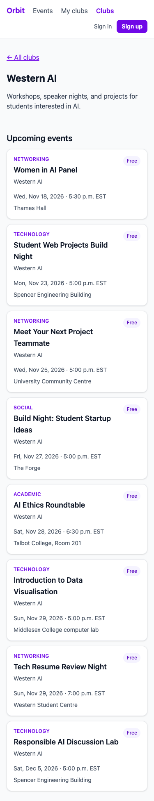
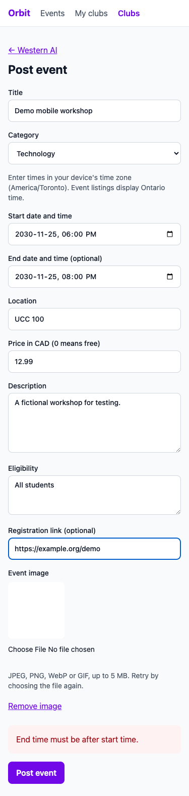
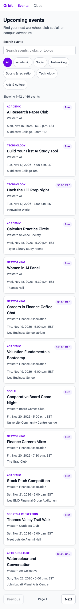
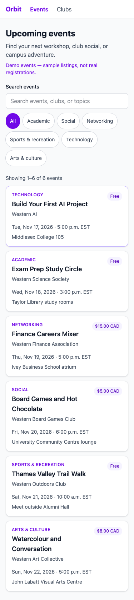
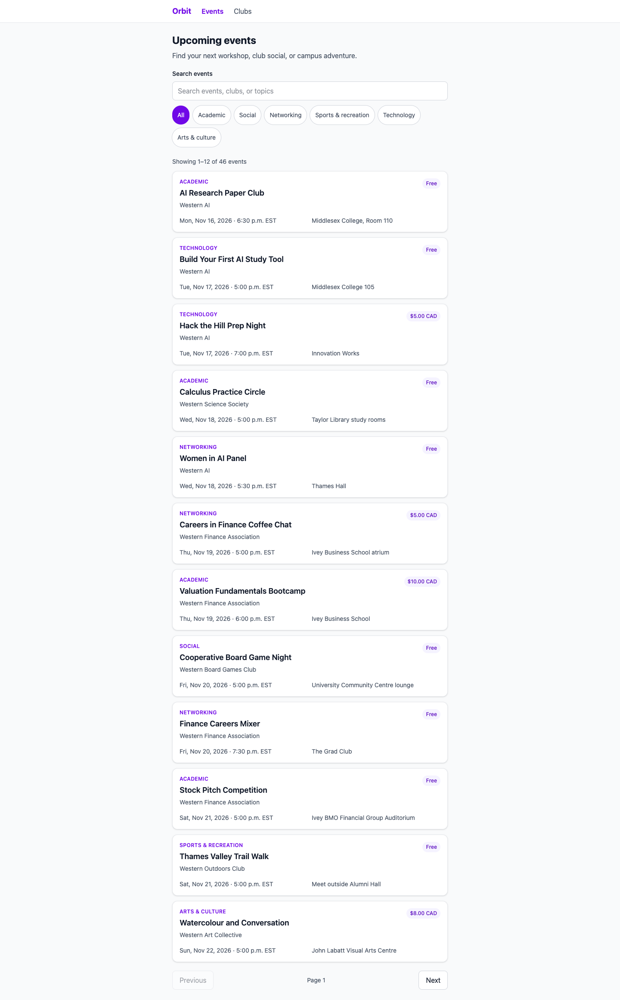

<!--
  WHAT: A ready-to-copy PR description following the team's existing template.
  WITHOUT IT: The reviewer would lack scope, dependency, and test evidence.
  LOCAL PREVIEW: Screenshot paths below are relative to this file. When copying
    into GitHub's PR description, attach the screenshots and use their uploaded links.
    The walkthrough URL will work on GitHub only after that file is committed/pushed.
-->

## What does this PR do?

Implements [Aryan's event discovery tasks](https://github.com/TristanPinzari/Orbit/blob/feature/aryan-event-discovery/docs/tasks/aryan.md): a mobile-friendly
event feed, search/categories, mock mode, event details, real API integration,
and demo data (24 upcoming events across all categories and nine clubs).

**Base: `main`.** Main `26997ef` was merged into the feature branch on
November 18, 2026 (`4a5ab04`). Main itself was not changed or pushed.
No unmerged Rokyo PR was imported. Teammates' schema, auth, and mutation routes
are preserved. Aryan adds feed response/query types, the feed router/mount, and
its API documentation; no duplicate events API or new schema is introduced.

The seed refreshes only its own stable demo event IDs and preserves unrelated rows.
It preserves main's refresh behavior, including clearing old fixture end times.
Demo registrations are clearly labelled examples, not real booking links.
See [the walkthrough](https://github.com/TristanPinzari/Orbit/blob/feature/aryan-event-discovery/docs/tasks/aryan-implementation.md) for file-by-file explanations.

### Review fixes

- Debounce search by 300 ms, including searching from a later page without an extra old-query request.
- Keep the previous successful cards while updating; show an Updating status and preserve correct page labels.
- Log the real seed error before the existing setup hint.
- Include the previously omitted walkthrough file, and reserve scrollbar space with `scrollbar-gutter: stable`.
- Leave URL-based filter persistence for later, as requested.

### New tasks — integrated with merged main; RSVP-dependent work remains pending

The working branch also contains public club detail plus real club creation,
post/edit/cancel forms, generic image uploads, settings/exec/ownership management,
My clubs, club following, and For you tabs/reasons. Prefer a separate follow-up
PR for these new tasks after finishing #18's review fixes.

Naksh's shared types and endpoints are now merged and used by the frontend.
Real authenticated workflows and storage uploads are tested. Main's sign-in/up
pages and user menu are retained. No silent mock fallback exists in live mode.
The real `/api/feed` query ranks followed clubs, then interests, then other events
with stable paging; followed-person/public-RSVP ranking remains pending Rokyo's
merged table. The persistent social seed is also pending. No RSVP, profile, or
onboarding UI is implemented here. No follower counts or lists are exposed.

## How did you test it?

November 18 checks:

- Main `26997ef` merged into this feature branch; `npm ci` and personal-Neon
  `db:push` succeeded without deleting existing events.
- Typecheck, production build, format and whitespace checks pass; 14 unit tests pass.
- Mock/API-contract browser tests cover debounce, mobile layout, roles, uploads,
  real contract shapes and safe recovery if club creation succeeds but details fail.
- Real personal-Neon checks cover sign-up/session, club creation and links/logo,
  event post/edit/cancel and persisted refresh, club settings and stable slug,
  exec add/promotion/removal/transfer, denied writes, following, My clubs and sign-in/out.
- Actual S3 club-logo/event-image PUTs, browser CORS and public image loading pass.
- Actual SQL feed: followed-club/interest priority, unique pages, totals for empty
  pages, 400/401 cases, cancellation exclusion, and mobile rendering pass.
- Temporary test accounts/clubs/events/images are removed after each live run;
  original database rows and private environment contents are preserved.
- `npm audit` reports four moderate findings in the existing Drizzle/esbuild-kit
  tooling dependency chain. No force-upgrade/downgrade was applied.

November 17 checks (historical):

- Whole-project typecheck and production build pass; 12 unit tests pass.
- Nine Chrome smoke groups pass: club/follow flows, creation and stable rename URLs,
  event post/edit/cancel and validation, exec roles and strong transfer confirmation,
  mobile layouts, one-request debounce from page two, retained cards/errors/races,
  signed-out restrictions, and uploads with failed PUT/retry/storage-key validation.
- Actual main API used for public Clubs/detail/club-filtered events/feed GETs only.
- No real writes, migrations, seed execution, or database deletion during this pass.
- Explicit full frontend-demo mode makes zero API requests and labels all mock saves.
- New screenshots cover club detail, event form, settings, and the For you demo feed.

Earlier November 14–16 verification (historical, not rerun seed claims):

- Reverified November 16, 2026, against main commit `fbaf86e` plus this feature's changes.
- `npm run typecheck`, `npm run build`, `npm run format:check`, and `git diff --check` passed.
- `node --import tsx --test tests/event-discovery.test.ts`: five checks passed.
- Applied Naksh's schema to my personal Neon branch; ran the seed twice; confirmed
  exactly 24 unique new upcoming demo events, all six categories, and nine clubs.
- Checked live Clubs list/search and both real event endpoints through Vite.
- Headless Chrome: search/category combinations, empty state, pagination, detail
  links/refresh/back, registration URLs, missing registration, cancelled/past events,
  invalid IDs, API errors/retry, and late-response handling passed.
- Mock events worked with backend requests blocked and made no event API requests.
- Confirmed main's blank-filter/default-pagination behavior and upcoming-only
  `from` boundary. Invalid categories return 400, and fixture end times reset to null.
- Checked widths 320, 375, 390, 768, and 1440px; no horizontal overflow or uncaught
  browser JavaScript errors. Older database events are retained; upcoming totals
  vary as those events pass.

## Screenshots

After screenshots (before screenshots were not captured):

November 17 additions (forms/settings/For you use fictional demo data):

November 16 event discovery screenshots:

