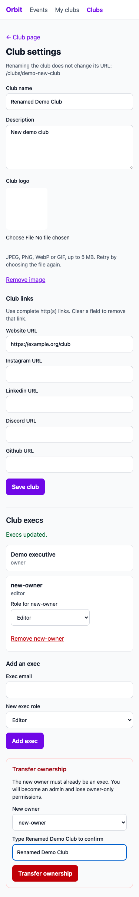
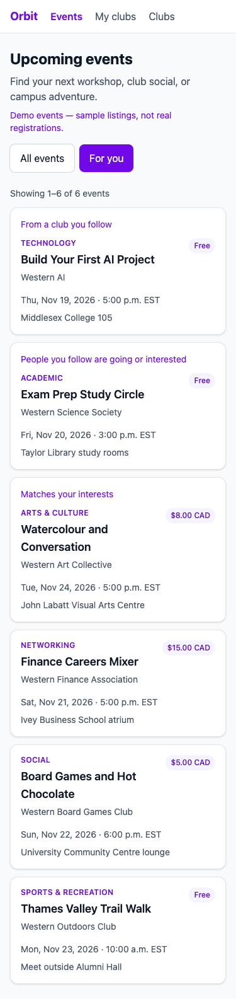
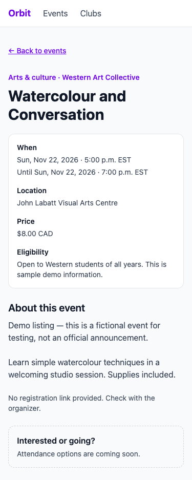

<!--
  WHAT: A ready-to-copy PR description following the team's existing template.
  WITHOUT IT: The reviewer would lack scope, dependency, and test evidence.
  LOCAL PREVIEW: Screenshot paths below are relative to this file. When copying
    into GitHub's PR description, attach the screenshots and use their uploaded links.
    Convert local documentation links to feature-branch URLs when copying to GitHub;
    the referenced files must be committed/pushed for those URLs to work.
    Editing this local draft does not update the GitHub PR body.
-->

## What does this PR do?

Implements [Aryan's event discovery and club exec tasks](./aryan.md): a
mobile-friendly event feed, search/categories, mock mode, event details, real API
integration, club/event management, and demo event listings (24 upcoming events
across all categories and nine clubs). Completes the privacy-safe For you feed,
URL-persisted filters, and settings continuity after saves and ownership transfers.

**Base: `main` at `3f62f04`, verified against the remote on November 19, 2026.**
Merged locally into `feature/aryan-event-discovery` at `9deb823`. The existing
settings-preservation fix `9cff53a` is also included. Nothing was pushed to main.
Rokyo's RSVP/profile privacy work and the newer silent-block behavior are now
merged dependencies, not blockers. Merge resolutions retain the upstream
profile, onboarding, People, and RSVP features alongside Aryan's club/feed work,
and remove duplicated shared feed declarations. No new database schema or
duplicate events API is introduced by the feed completion.

The seed refreshes only its own stable demo event IDs and preserves unrelated rows.
It preserves main's refresh behavior, including clearing old fixture end times.
Demo registrations are clearly labelled examples, not real booking links.
See [the earlier walkthrough](./aryan-implementation.md) for historical
file-by-file explanations and [the current task list](./aryan.md) for current status.

### Review fixes

- Debounce search by 300 ms, including searching from a later page without an extra old-query request.
- Keep the previous successful cards while updating; show an Updating status and preserve correct page labels.
- Log the real seed error before the existing setup hint.
- Include the previously omitted walkthrough file, and reserve scrollbar space with `scrollbar-gutter: stable`.
- Complete URL-based filter persistence, now part of the final tasks.

### Completed For you feed

- Rank by the highest matching group: followed clubs (3), public RSVPs by followed
  people (2), profile interests (1), then other upcoming events (0).
- Use `user_follow.follower_id = viewer` and `followee_id = RSVP user` for score 2;
  both Going and Interested qualify. Require `show_on_attendee_list = true`,
  LEFT JOIN the attendee's profile, and allow `is_public IS NULL OR is_public = true`.
  Exclude an attendee who blocked the viewer, matching current main's privacy rule.
- Return `reason: "followed_user"` and show exactly **People you follow are going**.
  Never include attendee identities or follower counts in the feed response.
- Preserve one parameterized SQL query, stable `score DESC, starts_at, id` ordering,
  no duplicate events, and correct totals even for empty out-of-range pages.
- Mark the feed complete in [API.md](../API.md#for-you-feed); remove the obsolete
  RSVP dependency note. Signed-out visitors continue to use All events.

### URL filters and navigation

- Store search (`q`), category, one-based page, and `tab=all|for-you` using
  `useSearchParams`; shared links, reloads, browser Back/Forward, and the detail
  page's Back to events link preserve the originating feed state.
- Keep search/category for All events when switching tabs; they do not filter
  For you. Filter and tab changes reset pagination.
- Keep a synchronous typing draft while committing the debounced query to the
  URL, preventing lost keystrokes during router transitions. Replace search
  history entries rather than adding an entry for every character.
- Handle Back during debounce, late responses, invalid parameters, and empty
  out-of-range pages without stale results or inverted result ranges.

### Club settings and existing exec workflows

The branch retains public club detail, creation, event post/edit/cancel forms,
generic image uploads, settings/exec management, My clubs, and club following,
using Naksh's merged endpoints. Live mode never silently falls back to mock data.

- Retain settings forms, unsaved fields, and success messages during refreshes
  after saves or ownership transfers.
- Keep form and exec-list keys distinct and stable across role changes; update
  permissions after transfer without remounting away the success message.

### Demo preparation and ownership

- Prepare [the feed demo runbook](./aryan-feed-demo.md) for Tristan: Jordan as the
  viewer, Alex as the RSVP actor, expected event order/reasons, and privacy/URL checks.
- **Task H belongs to Naksh.** His demo-account seed is already merged; this update
  does not create accounts, change the seeds, or run them.
- The For you feed covers the recommendation stretch goal; there is no separate
  recommendation feature left to build.

## How did you test it?

### November 19 verification for the current changes

- `npm run typecheck`, `npm run build`, and `git diff --check` passed. Changed
  source, tests, and documentation were formatted with the project's Prettier configuration.
- **24 SQL/unit tests passed** across [event discovery](../../tests/event-discovery.test.ts),
  [club exec/demo ranking](../../tests/club-exec.test.ts), and
  [production feed SQL](../../tests/feed-query.test.ts).
- The SQL suite builds the actual Drizzle schema in isolated PostgreSQL (PGlite)
  and executes the production query with account A following account B. It verifies
  public Going/Interested promotion; anonymous/private/blocked demotion; missing
  profiles; stale follows; direction of follows/blocks; highest-score precedence;
  duplicate prevention; stable pagination/totals; exclusion of past/cancelled
  events; and parameterized identity input. No hosted database is used.
- **All eight Chrome regression groups passed** in [feed-browser.mjs](../../tests/feed-browser.mjs):
  encoded/shared URLs and reload; both detail return paths; Back/Forward; debounce,
  pending-navigation typing and stale responses; tabs/pagination; delayed sessions
  and sign-out; invalid/empty/out-of-range pages; settings saves/transfers; and
  layouts at 320, 375, 768, and 1440px. No unexpected API traffic or React console
  errors remained. All API requests, including simulated writes, were intercepted.
- Extended [the opt-in live suite](../../tests/aryan-live.mjs) with real two-account
  RSVP/privacy/block transitions, but **did not run it against the hosted database**
  in this pass. Prior live results below are historical, not a new hosted verification.
- Rechecked remote main as `3f62f04` and confirmed it is an ancestor of the feature
  branch. The existing `.env` checksum is unchanged. No seed, migration, hosted
  database write, or push was performed during this completion pass.

Reproduction commands and temporary test-tool setup are in
[the verification runbook](./aryan-feed-demo.md#repeat-the-automated-checks-without-touching-the-configured-database).

### Remaining manual checks

- [ ] Rehearse the two-account scenario with the existing presentation accounts:
      public RSVP promotion, anonymous/private/blocked demotion, and recovery. Going
      private or blocking removes follows, so restoring visibility requires re-following.
- [ ] Confirm actual demo event order and account availability, then review the
      prepared runbook with Tristan. This coordination/rehearsal has not yet happened.

### November 18 checks (historical; not rerun against hosted services)

- Main `26997ef` merged into this feature branch; `npm ci` and personal-Neon
  `db:push` succeeded without deleting existing events.
- Typecheck, production build, format and whitespace checks pass; 14 unit tests pass.
- Mock/API-contract browser tests cover debounce, mobile layout, roles, uploads,
  real contract shapes and safe recovery if club creation succeeds but details fail.
- Real personal-Neon checks cover sign-up/session, club creation and links/logo,
  event post/edit/cancel and persisted refresh, club settings and stable slug,
  exec add/promotion/removal/transfer, denied writes, following, My clubs and sign-in/out.
- Actual S3 club-logo/event-image PUTs, browser CORS and public image loading pass.
- Actual SQL feed: followed-club/interest priority, unique pages, totals for empty
  pages, 400/401 cases, cancellation exclusion, and mobile rendering pass.
- Temporary test accounts/clubs/events/images are removed after each live run;
  original database rows and private environment contents are preserved.
- At that time, `npm audit` reported four moderate findings in the Drizzle/esbuild-kit
  tooling dependency chain. No force-upgrade/downgrade was applied.

### November 17 checks (historical)

- Whole-project typecheck and production build pass; 12 unit tests pass.
- Nine Chrome smoke groups pass: club/follow flows, creation and stable rename URLs,
  event post/edit/cancel and validation, exec roles and strong transfer confirmation,
  mobile layouts, one-request debounce from page two, retained cards/errors/races,
  signed-out restrictions, and uploads with failed PUT/retry/storage-key validation.
- Actual main API used for public Clubs/detail/club-filtered events/feed GETs only.
- No real writes, migrations, seed execution, or database deletion during this pass.
- Explicit full frontend-demo mode makes zero API requests and labels all mock saves.
- New screenshots cover club detail, event form, settings, and the For you demo feed.

### Earlier November 14–16 verification (historical, not rerun seed claims)

- Reverified November 16, 2026, against main commit `fbaf86e` plus this feature's changes.
- `npm run typecheck`, `npm run build`, `npm run format:check`, and `git diff --check` passed.
- `node --import tsx --test tests/event-discovery.test.ts`: five checks passed.
- Applied Naksh's schema to my personal Neon branch; ran the seed twice; confirmed
  exactly 24 unique new upcoming demo events, all six categories, and nine clubs.
- Checked live Clubs list/search and both real event endpoints through Vite.
- Headless Chrome: search/category combinations, empty state, pagination, detail
  links/refresh/back, registration URLs, missing registration, cancelled/past events,
  invalid IDs, API errors/retry, and late-response handling passed.
- Mock events worked with backend requests blocked and made no event API requests.
- Confirmed main's blank-filter/default-pagination behavior and upcoming-only
  `from` boundary. Invalid categories return 400, and fixture end times reset to null.
- Checked widths 320, 375, 390, 768, and 1440px; no horizontal overflow or uncaught
  browser JavaScript errors. Older database events are retained; upcoming totals
  vary as those events pass.

## Screenshots

After screenshots (before screenshots were not captured):

These are historical screenshots, not new captures of the November 19 URL-state
and feed changes. In particular, the old For you image may show the earlier label.

November 17 additions (forms/settings/For you use fictional demo data):

November 16 event discovery screenshots:

